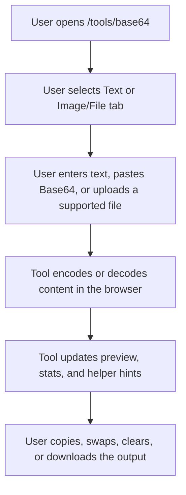

## 1. Product Overview
Add a fully client-side Base64 Encoder/Decoder tool to `codewithlogs.com` under the existing public tools section.
- The tool helps developers, designers, and content editors encode and decode Base64 text, inspect Base64 image/file data, and convert supported files without sending data to any server.
- The page expands the tools library with a practical browser utility that supports SEO content and existing `AdUnit` placements.

## 2. Core Features

### 2.1 Feature Module
1. **Tools landing page**: live tool card updates and available tools grid
2. **Base64 page**: text conversion, image/file conversion, URL-safe toggle, stats, preview, and SEO content

### 2.2 Page Details
| Page Name | Module Name | Feature description |
|-----------|-------------|---------------------|
| Tools page | Available tools grid | Add Base64 Encoder/Decoder as a live tool card linking to `/tools/base64` |
| Base64 page | Tool shell | Render H1, short supporting copy, tab switcher, and top ad placement |
| Base64 page | Text tab | Provide input/output textareas, Encode, Decode, Copy Output, Swap Input/Output, and Clear actions |
| Base64 page | Base64 hinting | Detect Base64-like input and show a decode suggestion message |
| Base64 page | Image/File tab | Support drag-and-drop and file browsing for images, text, and JSON files |
| Base64 page | Image preview | Show an image preview when uploaded or pasted Base64 resolves to an image data URL |
| Base64 page | File conversion output | Display the full Base64 string and support copy and `.txt` download actions |
| Base64 page | Reverse preview | Allow users to paste Base64 image data and render the preview in-browser |
| Base64 page | URL-safe toggle | Replace `+` and `/` with `-` and `_` during output generation when enabled |
| Base64 page | Stats bar | Show input size, output size, and conversion ratio |
| Base64 page | Error handling | Show a clear invalid Base64 error if decoding fails |
| Base64 page | SEO content | Render educational sections and FAQ below the tool |
| Base64 page | Bottom ad | Render existing `AdUnit` placement below the tool content |

## 3. Core Process
Visitors open `/tools/base64`, choose either text conversion or image/file conversion, process content fully in the browser, review output and stats, then copy, download, or swap values as needed.

## 4. User Interface Design
### 4.1 Design Style
- Primary color: `#0F6E56`
- Supporting colors: white, soft neutral surfaces, muted slate borders, and red/amber feedback states for errors and hints
- Button style: rounded pill controls with clear primary and secondary hierarchy
- Font style: existing site typography for headings and body with monospace textareas for encoded output and file data
- Layout style: desktop-first tool card with tabbed sections, stacked mobile adaptation, and consistent utility spacing
- Icon style suggestions: `lucide-react` only with lightweight upload, file, image, copy, and swap icon usage

### 4.2 Page Design Overview
| Page Name | Module Name | UI Elements |
|-----------|-------------|-------------|
| Base64 page | Tool shell | Rounded container, strong heading hierarchy, tab switcher, light utility styling |
| Base64 page | Text tab | Large textareas, compact action row, hint banner, stats strip |
| Base64 page | Image/File tab | Drag-and-drop panel, browse button, preview card, output viewer, download actions |
| Base64 page | URL-safe toggle | Inline checkbox with helper text about `+` and `/` replacement |
| Base64 page | SEO content | Editorial sections with FAQ cards matching the tools library tone |
| Tools page | Tool cards | Live badge for Base64 and consistent card styling with the other tool entries |

### 4.3 Responsiveness
- Desktop-first layout with spacious tabs and side-by-side action groupings where space allows
- Mobile layout stacks controls, textareas, preview, and stats vertically without horizontal scrolling
- Drag-and-drop zone and output panels remain touch-friendly on smaller screens
- Long Base64 strings wrap or scroll safely inside output areas without breaking the layout
