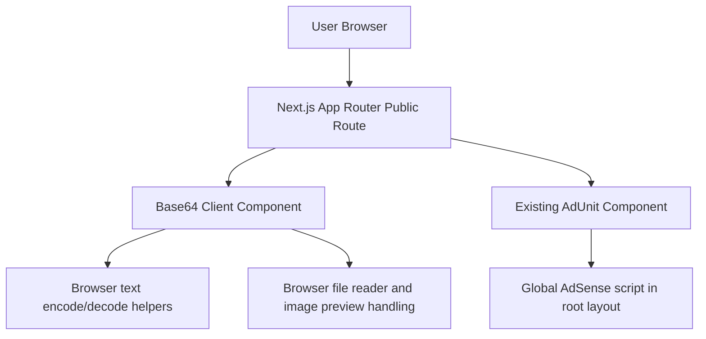

## 1. Architecture Design


## 2. Technology Description
- Framework: Next.js App Router in the existing project structure
- Language: TypeScript + React client components
- Styling: Tailwind CSS using the current tools page design language
- Encoding: browser-native `btoa()` and `atob()` with UTF-8 normalization helpers
- File handling: `FileReader`, `Blob`, and object URLs/data URLs in the browser only
- Ads: existing `AdUnit` component with new slot names for Base64 placements
- SEO: route-level `metadata` export with canonical URL and supporting educational copy

## 3. Route Definitions
| Route | Purpose |
|-------|---------|
| `/tools` | Public tools landing page with live and upcoming tools |
| `/tools/base64` | Public Base64 Encoder/Decoder page for text and image/file conversion |

## 4. API Definitions
No backend API is required.

All text conversion, Base64 detection, file reading, preview rendering, copying, and downloading run entirely in the browser. No user data is uploaded or persisted.

## 5. Component Architecture
| Component | Responsibility |
|-----------|----------------|
| `src/app/(public)/tools/base64/page.tsx` | Route metadata and page composition |
| `src/components/tools/Base64Tool.tsx` | Client-side tabs, text conversion, file handling, previews, stats, and actions |
| `src/components/tools/Base64SeoContent.tsx` | Informational content below the tool |
| `src/lib/base64.ts` | UTF-8-safe text encode/decode helpers, Base64 detection, URL-safe transforms, ratio sizing, and file utility helpers |

## 6. Data Model
### 6.1 In-Memory State Model
```ts
type Base64Tab = "text" | "file";

type Base64Preview = {
  mimeType: string;
  dataUrl: string;
} | null;

type Base64FileState = {
  fileName: string;
  mimeType: string;
  base64: string;
  preview: Base64Preview;
};

type Base64ToolState = {
  activeTab: Base64Tab;
  input: string;
  output: string;
  isUrlSafe: boolean;
  errorMessage: string;
  fileState: Base64FileState | null;
};
```

### 6.2 Processing Rules
- Encode text with UTF-8 handling before passing data into `btoa()`
- Decode text with `atob()` and convert bytes back to Unicode safely
- Detect Base64-like content using a regex hint and optional padding normalization
- Apply URL-safe transforms only to generated output, not to raw user input until decode normalization runs
- Accept supported images, plain text files, and JSON files in the upload flow
- Read files with `FileReader` and extract the Base64 payload from the resulting data URL
- Generate image previews from data URLs when the MIME type is an image
- Support reverse preview by converting pasted Base64 into a valid image data URL when possible
- Show clear errors for invalid Base64 input or unsupported file types
- Create `.txt` downloads in-browser with `Blob` and `URL.createObjectURL`

## 7. Ad Integration
- Extend the existing `AdUnit` slot mapping with:
  - `base64-top`
  - `base64-bottom`
- Render one top placement above the tool
- Render one bottom placement below the tool content

## 8. Testing and Verification
- Check editor diagnostics for all new and changed files
- Run `npm run build`
- Manual verification:
  - text encoding works for ASCII and Unicode input
  - invalid Base64 shows a clear decode error
  - URL-safe toggle changes output formatting correctly
  - file upload converts supported files and shows Base64 output
  - image upload and pasted image Base64 both render previews
  - copy and `.txt` download actions work
  - `/tools` shows Base64 as a live tool
