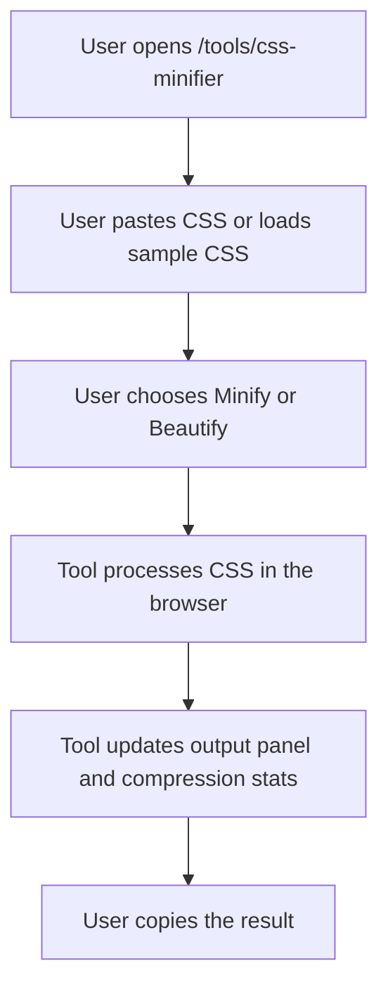

## 1. Product Overview
Add a fully client-side CSS Minifier tool to `codewithlogs.com` under the existing public tools section.
- The tool helps developers instantly minify and beautify CSS in the browser with no uploads, using a familiar two-panel workflow similar to the JSON Formatter.
- The page also supports search visibility through educational SEO content and existing `AdUnit` placements while keeping all CSS processing local to the user.

## 2. Core Features

### 2.1 Feature Module
1. **Tools landing page**: live tool card updates, available tools grid, coming soon tools grid
2. **CSS Minifier page**: CSS input, processed output, action controls, stats strip, sample loader, SEO content

### 2.2 Page Details
| Page Name | Module Name | Feature description |
|-----------|-------------|---------------------|
| Tools page | Available tools grid | Add CSS Minifier as a live tool card linking to `/tools/css-minifier` |
| Tools page | Coming soon grid | Keep the remaining planned tools as placeholder cards |
| CSS Minifier page | Tool header | Render the H1, description, and top ad placement |
| CSS Minifier page | Two-panel editor | Show input CSS on the left and processed output on the right with monospace styling and line numbers |
| CSS Minifier page | Action controls | Provide Minify CSS, Beautify CSS, Clear, Copy Output, and Sample CSS actions |
| CSS Minifier page | Stats strip | Show original size, minified size, and savings percentage |
| CSS Minifier page | CSS minification | Remove comments, collapse whitespace, remove unnecessary semicolons, and preserve quoted strings |
| CSS Minifier page | CSS beautification | Apply 2-space indentation, one property per line, and clean brace formatting |
| CSS Minifier page | Error handling | Detect invalid CSS structure and show helpful error states |
| CSS Minifier page | SEO content | Render minification explanations, usage guidance, and FAQ |
| CSS Minifier page | Bottom ad | Render existing `AdUnit` placement below the tool content |

## 3. Core Process
Visitors paste CSS or load sample CSS, run minify or beautify actions, review output and compression stats, then copy the result for development or deployment use.

## 4. User Interface Design
### 4.1 Design Style
- Primary color: `#0F6E56`
- Supporting colors: teal-first with subtle neutrals for editor surfaces and error states
- Backgrounds: white and soft neutral panels matching the existing tools pages
- Button style: rounded controls with clear primary and secondary emphasis
- Fonts: existing site typography for page content, monospace for CSS editors
- Layout style: desktop-first split editor layout with stacked mobile adaptation
- Icon style suggestions: `lucide-react` only with restrained utility icon use

### 4.2 Page Design Overview
| Page Name | Module Name | UI Elements |
|-----------|-------------|-------------|
| CSS Minifier page | Tool shell | Rounded split editor, strong utility hierarchy, subtle shadows |
| CSS Minifier page | Input panel | Large textarea, line numbers, muted helper text, monospace styling |
| CSS Minifier page | Output panel | Code-like surface, line numbers, scrollable output area |
| CSS Minifier page | Controls | Rounded action buttons with clear primary and secondary states |
| CSS Minifier page | Stats strip | Highlighted summary row with teal savings emphasis |
| CSS Minifier page | SEO content | Editorial sections, list content, FAQ cards |
| Tools page | Tool cards | Live badge for CSS Minifier and consistent tool card styling |

### 4.3 Responsiveness
- Desktop-first layout with two equal-width panels
- Mobile layout stacks input, controls, output, and stats vertically
- Long CSS lines scroll horizontally without breaking layout
- Action buttons wrap cleanly on smaller screens
- Stats strip remains readable across mobile and desktop
