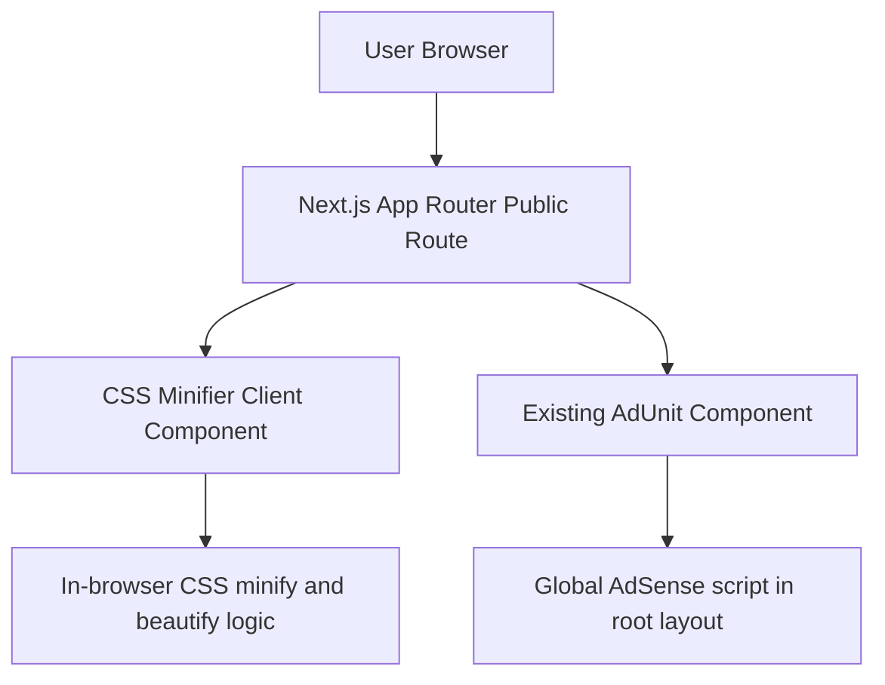

## 1. Architecture Design


## 2. Technology Description
- Framework: Next.js App Router in the existing project structure
- Language: TypeScript + React client components
- Styling: Tailwind CSS using the current site tokens and utility patterns
- CSS processing: browser-only string parsing and formatting logic with no external libraries
- Ads: existing `AdUnit` component with new slot names for CSS minifier placements
- SEO: route-level `metadata` export with canonical URL and supporting copy

## 3. Route Definitions
| Route | Purpose |
|-------|---------|
| `/tools` | Public tools landing page with live and upcoming tools |
| `/tools/css-minifier` | Public CSS minifier and beautifier tool page |

## 4. API Definitions
No backend API is required.

All minification, beautification, validation checks, stats calculations, and copy actions run entirely in the browser. No CSS is stored or transmitted.

## 5. Component Architecture
| Component | Responsibility |
|-----------|----------------|
| `src/app/(public)/tools/css-minifier/page.tsx` | Route metadata and page composition |
| `src/components/tools/CssMinifierTool.tsx` | Client-side tool state, editors, controls, stats, and layout |
| `src/components/tools/CssMinifierSeoContent.tsx` | Informational content below the tool |
| `src/components/tools/CodeLineView.tsx` | Shared code panel with line numbers for input or output |
| `src/lib/css-minifier.ts` | CSS minify, beautify, validation helpers, size formatting, and sample CSS |

## 6. Data Model
### 6.1 In-Memory State Model
```ts
type CssToolMode = "idle" | "minified" | "beautified";

type CssToolState = {
  input: string;
  output: string;
  errorMessage: string;
  copied: boolean;
  mode: CssToolMode;
};
```

### 6.2 Processing Rules
- Process CSS on explicit button actions rather than every keystroke
- Remove CSS comments while preserving quoted strings
- Collapse redundant whitespace safely
- Remove semicolons immediately before `}`
- Beautify with 2-space indentation and one property per line
- Detect obvious invalid CSS such as unbalanced braces and unterminated strings/comments
- Calculate original and processed sizes in bytes and kilobytes

## 7. Ad Integration
- Extend the existing `AdUnit` slot mapping with:
  - `css-minifier-top`
  - `css-minifier-bottom`
- Render one top placement above the tool
- Render one bottom placement below the tool content

## 8. Testing and Verification
- Check editor diagnostics for all new and changed files
- Run `npm run build`
- Manual verification:
  - sample CSS loads correctly
  - minify removes comments and unnecessary whitespace
  - beautify formats CSS with indentation and line breaks
  - invalid CSS shows an error state
  - `/tools` shows CSS Minifier as a live tool
