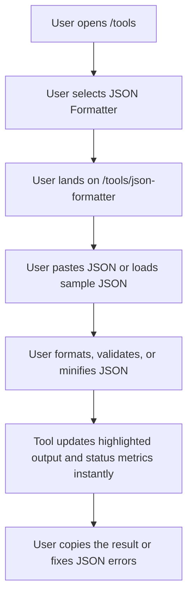

## 1. Product Overview
Add a fast, fully client-side JSON Formatter & Validator tool to `codewithlogs.com` under the public tools section.
- The tool helps developers, API users, and learners instantly format, minify, validate, and inspect JSON without sending any data to a server.
- The page also supports SEO growth by combining a useful interactive tool with strong search-intent content and on-page ad placements.

## 2. Core Features

### 2.1 Feature Module
1. **Tools landing page**: tools hero section, available tool cards, coming soon tools grid
2. **JSON Formatter page**: JSON input editor, action controls, formatted output, status metrics, educational content

### 2.2 Page Details
| Page Name | Module Name | Feature description |
|-----------|-------------|---------------------|
| Tools page | Tools grid | Show the JSON Formatter as an available tool and show placeholder cards for upcoming tools |
| Tools page | SEO intro | Explain the tools section briefly and guide users into the available utilities |
| JSON Formatter page | Tool header | Render H1, short description, trust messaging, and ad placement above the tool |
| JSON Formatter page | Input panel | Large monospace textarea with placeholder and client-side editing |
| JSON Formatter page | Action controls | Format & Validate, Minify, Clear, Copy Output, Sample JSON, indent selector |
| JSON Formatter page | Output panel | Syntax-highlighted JSON with line numbers and scrollable output region |
| JSON Formatter page | Status bar | Show valid/error state, exact parse error, character count, line count, and key count |
| JSON Formatter page | SEO content | Render explainer sections, error guidance, and FAQ content below the tool |
| JSON Formatter page | Ad placement | Render top horizontal ad and bottom rectangle ad using the existing `AdUnit` component |

## 3. Core Process
Visitors discover the tools page, open the JSON Formatter page, paste or load sample JSON, choose indentation, format or minify the content, review validation feedback, then copy the result for use in APIs, MongoDB documents, configuration files, or REST responses.

## 4. User Interface Design
### 4.1 Design Style
- Primary color: `#0F6E56`
- Accent colors: blue for keys, green for strings, orange for numbers, purple for booleans/null
- Backgrounds: clean white with soft neutral panels and subtle borders
- Button style: rounded pills and rounded rectangles with clear action hierarchy
- Fonts: existing site typography for page copy, monospace for editors and formatted output
- Layout style: desktop-first split tool layout with stacked mobile adaptation
- Icon style suggestions: `lucide-react` only, minimal utility icons where helpful

### 4.2 Page Design Overview
| Page Name | Module Name | UI Elements |
|-----------|-------------|-------------|
| Tools page | Hero | Clear tools heading, concise intro, subtle card grid preview |
| Tools page | Tool cards | Rounded cards, clear availability badges, strong hover states |
| JSON Formatter page | Tool shell | Two balanced panels, sticky-feeling controls, generous spacing |
| JSON Formatter page | Input panel | Large textarea, muted label, helper text, monospace styling |
| JSON Formatter page | Output panel | Code-like surface, line numbers, syntax colors, empty state |
| JSON Formatter page | Status bar | Success/error badge, compact metrics chips, instant feedback |
| JSON Formatter page | SEO content | Readable editorial blocks with numbered list, bullet list, and FAQ cards |

### 4.3 Responsiveness
- Desktop-first layout with equal-width columns for input and output
- Mobile layout stacks input, controls, output, and status naturally
- Buttons wrap cleanly on smaller screens
- Output area supports horizontal scrolling for long JSON lines
- Ad containers remain full width and visually separated from tool content
