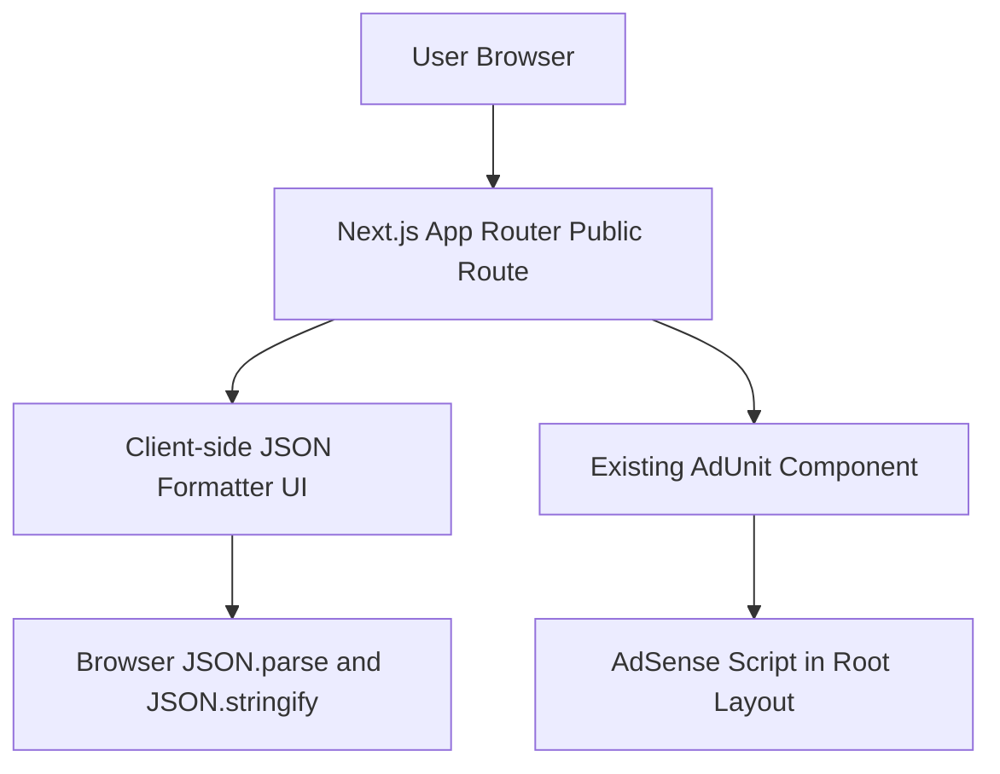

## 1. Architecture Design


## 2. Technology Description
- Framework: Next.js App Router in the existing project structure
- Language: TypeScript + React client components
- Styling: Tailwind CSS using the project color system and utility classes
- Data processing: native browser `JSON.parse()` and `JSON.stringify()` only
- Ads: existing `AdUnit` component with new slot names for the JSON tool page
- SEO: route-level `metadata` export with canonical URL and descriptive content

## 3. Route Definitions
| Route | Purpose |
|-------|---------|
| `/tools` | Public tools landing page listing current and upcoming tools |
| `/tools/json-formatter` | Public client-side JSON formatter, validator, and minifier tool |

## 4. API Definitions
No backend API is required.

All formatting, minifying, validation, counting, and copying run locally in the browser. No request is sent to the server for tool usage.

## 5. Component Architecture
| Component | Responsibility |
|-----------|----------------|
| `src/app/(public)/tools/page.tsx` | Tools landing page UI and tool card grid |
| `src/app/(public)/tools/json-formatter/page.tsx` | Route metadata and page composition |
| `src/components/tools/JsonFormatterTool.tsx` | Client-side formatter shell, state, actions, and panels |
| `src/components/tools/JsonSyntaxHighlighter.tsx` | Render syntax-highlighted JSON with line numbers |

## 6. Data Model
### 6.1 In-Memory State Model
```ts
type IndentMode = 2 | 4 | "\t";

type JsonToolState = {
  input: string;
  output: string;
  status: "idle" | "valid" | "error";
  errorMessage: string;
  indentMode: IndentMode;
  characterCount: number;
  lineCount: number;
  keyCount: number;
};
```

### 6.2 Processing Rules
- Parse input with `JSON.parse()`
- Format output with `JSON.stringify(parsed, null, indent)`
- Minify output with `JSON.stringify(parsed)`
- Count keys recursively across objects
- Derive line count from rendered output or input fallback
- Preserve exact parse errors from the browser where possible
- Use memoized token rendering for syntax-highlighted output without third-party libraries

## 7. Ad Integration
- Extend the existing `AdUnit` slot mapping with:
  - `json-tool-top`
  - `json-tool-bottom`
- Render top horizontal ad above the tool shell
- Render bottom rectangle ad below the SEO content or directly below the tool section, based on page balance

## 8. Testing and Verification
- Type-check and lint via project diagnostics
- Run production build with `npm run build`
- Manual browser verification:
  - valid JSON formatting
  - minify behavior
  - clear action
  - copy output action
  - sample JSON loader
  - invalid JSON error reporting
  - responsive layout for mobile and desktop
