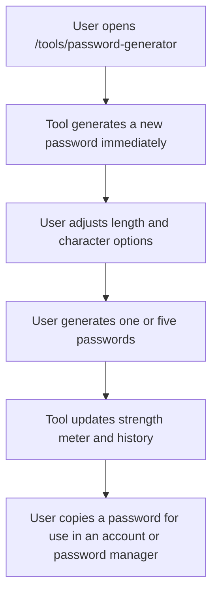

## 1. Product Overview
Add a fully client-side Password Generator tool to `codewithlogs.com` inside the existing public tools section.
- The tool helps developers and general users instantly create strong passwords with customizable rules, quick copying, multiple-password generation, and temporary in-session history.
- The page also supports search visibility through a focused SEO content section and existing `AdUnit` placements without sending any password data to any server.

## 2. Core Features

### 2.1 Feature Module
1. **Tools landing page**: live tool card updates, available tools grid, coming soon tools grid
2. **Password Generator page**: generator controls, password display, strength feedback, multi-password list, history panel, SEO content

### 2.2 Page Details
| Page Name | Module Name | Feature description |
|-----------|-------------|---------------------|
| Tools page | Available tools grid | Add Password Generator as a live tool card linking to `/tools/password-generator` |
| Tools page | Coming soon grid | Keep the remaining planned tools as placeholder cards |
| Password Generator page | Tool header | Render the H1, privacy trust message, and top ad placement |
| Password Generator page | Password display box | Show the generated password in a large monospace box with inline copy control |
| Password Generator page | Strength indicator | Show Weak, Fair, Good, or Strong with colored progress styling |
| Password Generator page | Generator controls | Support length slider, character type checkboxes, and ambiguous character exclusion |
| Password Generator page | Action buttons | Generate password and copy to clipboard with copied toast feedback |
| Password Generator page | Multiple passwords | Generate 5 passwords at once and allow copying each one independently |
| Password Generator page | Password history | Keep the last 10 generated passwords in React state with collapse and clear actions |
| Password Generator page | SEO content | Render explainer copy, strength comparison table, usage steps, and FAQ |
| Password Generator page | Bottom ad | Render existing `AdUnit` rectangle placement below the tool content |

## 3. Core Process
Visitors open the password generator page, receive a fresh password automatically on page load, adjust length and character options, generate new passwords, copy the result, optionally generate five alternatives, and review recent password history during the current session.

## 4. User Interface Design
### 4.1 Design Style
- Primary color: `#0F6E56`
- Supporting colors: red, orange, blue, and green for strength states
- Backgrounds: clean white and soft neutral surfaces aligned with the existing tools pages
- Button style: rounded controls with clear primary and secondary emphasis
- Fonts: existing site typography for page content, monospace for generated passwords
- Layout style: desktop-first content blocks with stacked mobile adaptation
- Icon style suggestions: `lucide-react` only with restrained utility icon use

### 4.2 Page Design Overview
| Page Name | Module Name | UI Elements |
|-----------|-------------|-------------|
| Password Generator page | Hero and shell | High-clarity intro, privacy reassurance, rounded panels, subtle shadows |
| Password Generator page | Password display | Large monospace field, inline copy action, strength meter, immediate feedback |
| Password Generator page | Controls | Slider, checkboxes, toggle, compact descriptive labels, responsive spacing |
| Password Generator page | Multi-password list | Five-item list with copy actions and subtle hover states |
| Password Generator page | History panel | Collapsible section with recent passwords and clear-history control |
| Password Generator page | SEO content | Editorial content blocks, table, numbered list, FAQ cards |
| Tools page | Tool cards | Live badge for Password Generator and consistent tool card styling |

### 4.3 Responsiveness
- Desktop-first tool layout with clear section separation
- Mobile layout stacks display, controls, actions, multi-passwords, and history vertically
- Buttons wrap cleanly on narrow screens
- Long passwords scroll horizontally inside monospace boxes without breaking layout
- Table and history panel remain readable on small devices with proper overflow handling
