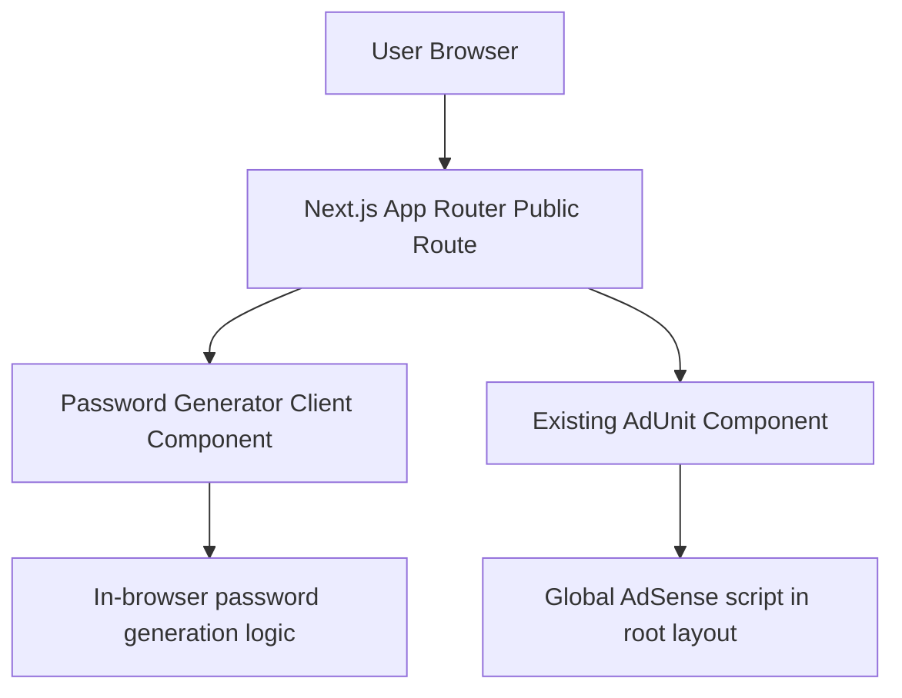

## 1. Architecture Design


## 2. Technology Description
- Framework: Next.js App Router in the existing project structure
- Language: TypeScript + React client components
- Styling: Tailwind CSS using existing site tokens and spacing conventions
- Password generation: browser-only random generation using native JavaScript
- Ads: existing `AdUnit` component with new slot names for password generator placements
- SEO: route-level `metadata` export with canonical URL and descriptive copy

## 3. Route Definitions
| Route | Purpose |
|-------|---------|
| `/tools` | Public tools landing page with live and upcoming tools |
| `/tools/password-generator` | Public password generator page with controls, history, and SEO content |

## 4. API Definitions
No backend API is required.

All password generation, copying, strength analysis, multi-password generation, and history tracking run locally in the browser. No password is stored or transmitted.

## 5. Component Architecture
| Component | Responsibility |
|-----------|----------------|
| `src/app/(public)/tools/password-generator/page.tsx` | Route metadata and tool page composition |
| `src/components/tools/PasswordGeneratorTool.tsx` | Client-side tool state, controls, generation actions, and layout |
| `src/components/tools/PasswordStrengthMeter.tsx` | Strength label, bar, and supporting helper text |
| `src/components/tools/PasswordToolSeoContent.tsx` | Informational content section below the generator |

## 6. Data Model
### 6.1 In-Memory State Model
```ts
type PasswordOptions = {
  length: number;
  includeUppercase: boolean;
  includeLowercase: boolean;
  includeNumbers: boolean;
  includeSymbols: boolean;
  excludeAmbiguous: boolean;
};

type PasswordStrength = "weak" | "fair" | "good" | "strong";

type PasswordToolState = {
  currentPassword: string;
  generatedBatch: string[];
  history: string[];
  copiedValue: string | null;
  isHistoryOpen: boolean;
  options: PasswordOptions;
};
```

### 6.2 Processing Rules
- Generate at least one fresh password on initial page load
- Ensure generated passwords use only the user-selected character sets
- Prevent empty character pools by requiring at least one character type
- Remove ambiguous characters when that toggle is enabled
- Classify strength using length and enabled character-type count
- Keep only the most recent 10 history entries in memory
- Show a short-lived copied toast for two seconds after copy actions

## 7. Ad Integration
- Extend the existing `AdUnit` slot mapping with:
  - `password-generator-top`
  - `password-generator-bottom`
- Render one horizontal ad above the tool
- Render one rectangle ad below the tool content

## 8. Testing and Verification
- Check TypeScript and editor diagnostics for new and changed files
- Run `npm run build`
- Manual browser verification:
  - fresh password appears on page load
  - slider and toggles update generator behavior
  - copy actions show the copied toast
  - five-password generation works
  - history caps at 10 entries and can be cleared
  - `/tools` includes the live Password Generator card
