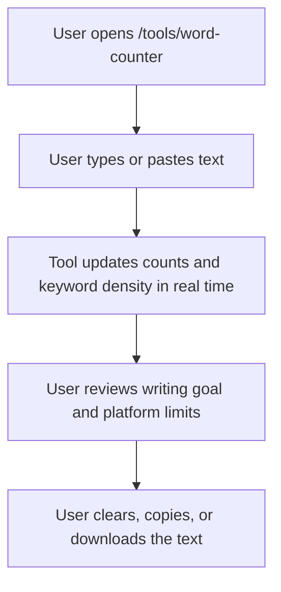

## 1. Product Overview
Add a fully client-side Word Counter tool to `codewithlogs.com` under the existing public tools section.
- The tool helps writers, bloggers, students, marketers, and developers measure words, characters, sentences, paragraphs, reading time, keyword density, and progress toward writing goals in real time.
- The page also supports search visibility with helpful educational content and existing `AdUnit` placements while keeping all text processing in the browser only.

## 2. Core Features

### 2.1 Feature Module
1. **Tools landing page**: live tool card updates, available tools grid, coming soon tools grid
2. **Word Counter page**: textarea, stats grid, keyword density, writing goal tracker, controls, platform limits, SEO content

### 2.2 Page Details
| Page Name | Module Name | Feature description |
|-----------|-------------|---------------------|
| Tools page | Available tools grid | Add Word Counter as a live tool card linking to `/tools/word-counter` |
| Tools page | Coming soon grid | Keep the remaining planned tools as placeholder cards |
| Word Counter page | Tool header | Render H1, supporting description, and top ad placement |
| Word Counter page | Text input | Large auto-resizing textarea with real-time stat updates on every keystroke |
| Word Counter page | Stats grid | Show words, characters with spaces, characters without spaces, sentences, paragraphs, and reading time |
| Word Counter page | Keyword density | Show top 10 non-stop words with count and density percentage |
| Word Counter page | Writing goals | Allow setting a word goal, show progress, and display success state when reached |
| Word Counter page | Controls | Provide Clear Text, Copy Text, and Download as `.txt` actions |
| Word Counter page | Social media limits | Show platform character limits with status colors based on current length |
| Word Counter page | SEO content | Render educational sections, content-type guidance, and FAQ |
| Word Counter page | Bottom ad | Render existing `AdUnit` placement below the tool content |

## 3. Core Process
Visitors paste or type text into the Word Counter page, see all writing metrics update instantly, review keyword density and social limit status, optionally set a target word goal, then copy or download their content.

## 4. User Interface Design
### 4.1 Design Style
- Primary color: `#0F6E56`
- Supporting colors: teal-first with supporting green, yellow, and red for status feedback
- Backgrounds: white and soft neutral surfaces matching the existing tools pages
- Button style: rounded controls with clear primary and secondary hierarchy
- Fonts: existing site typography for headings and body, comfortable readable textarea styles
- Layout style: desktop-first sections with stacked mobile adaptation
- Icon style suggestions: `lucide-react` only with concise, utility-focused usage

### 4.2 Page Design Overview
| Page Name | Module Name | UI Elements |
|-----------|-------------|-------------|
| Word Counter page | Tool shell | Rounded cards, clear hierarchy, strong stat emphasis, light utility styling |
| Word Counter page | Text input | Auto-resizing textarea, muted helper copy, spacious editing area |
| Word Counter page | Stats grid | Six strong cards with large teal numbers and compact labels |
| Word Counter page | Keyword density | Clean table, subtle row separators, clear percentages |
| Word Counter page | Writing goals | Input, progress bar, completion badge, responsive stacking |
| Word Counter page | Social limits | Platform cards with colored status indicators |
| Word Counter page | SEO content | Editorial blocks, list content, FAQ cards |
| Tools page | Tool cards | Live badge for Word Counter and consistent tool card styling |

### 4.3 Responsiveness
- Desktop-first layout with grouped sections and even card rhythm
- Mobile layout stacks textarea, stat cards, goal tracker, tables, and limit cards vertically
- Stats grid collapses cleanly from six columns to smaller responsive layouts
- Tables support small-screen readability without breaking layout
- Controls wrap cleanly on narrow screens
