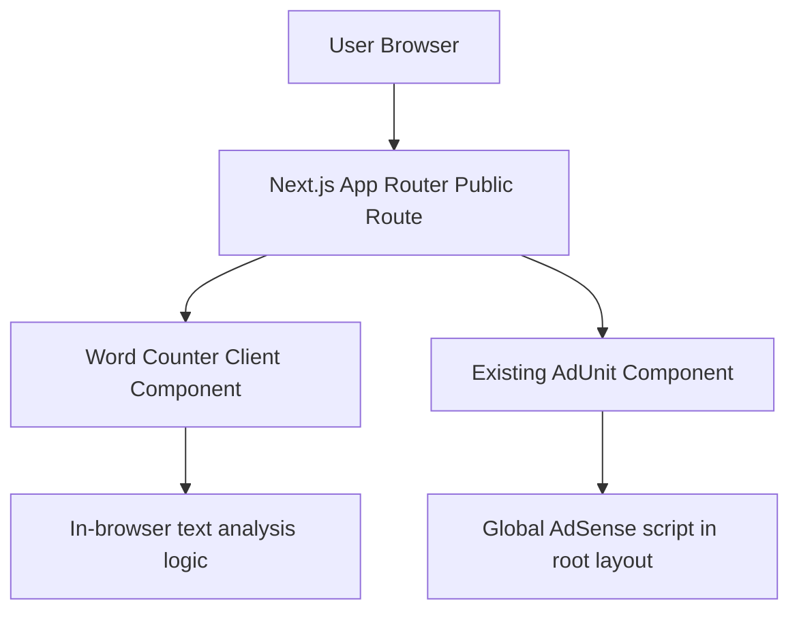

## 1. Architecture Design


## 2. Technology Description
- Framework: Next.js App Router in the existing project structure
- Language: TypeScript + React client components
- Styling: Tailwind CSS using the current site tokens and utility patterns
- Text analysis: browser-only string parsing and memoized derived metrics
- Ads: existing `AdUnit` component with new slot names for word counter placements
- SEO: route-level `metadata` export with canonical URL and supporting copy

## 3. Route Definitions
| Route | Purpose |
|-------|---------|
| `/tools` | Public tools landing page with live and upcoming tools |
| `/tools/word-counter` | Public real-time word counter page with stats, goals, limits, and SEO content |

## 4. API Definitions
No backend API is required.

All counting, keyword analysis, progress tracking, copying, and downloading run entirely in the browser. No text is stored or transmitted.

## 5. Component Architecture
| Component | Responsibility |
|-----------|----------------|
| `src/app/(public)/tools/word-counter/page.tsx` | Route metadata and page composition |
| `src/components/tools/WordCounterTool.tsx` | Client-side textarea, derived stats, controls, and layout |
| `src/components/tools/WordCounterSeoContent.tsx` | Informational content below the tool |
| `src/lib/word-counter.ts` | Text analysis, stop-word filtering, density logic, and platform-limit helpers |

## 6. Data Model
### 6.1 In-Memory State Model
```ts
type KeywordDensityRow = {
  word: string;
  count: number;
  density: number;
};

type PlatformLimit = {
  label: string;
  limit: number;
  status: "safe" | "warning" | "danger";
};

type WordCounterState = {
  text: string;
  wordGoal: number | "";
};
```

### 6.2 Processing Rules
- Recalculate all metrics on every textarea keystroke
- Count words using trimmed tokenized content
- Count characters with and without spaces
- Detect sentences using `.`, `!`, and `?`
- Detect paragraphs using double line breaks
- Estimate reading time using `200` words per minute
- Filter common stop words from keyword density results
- Return the top 10 keyword rows sorted by frequency
- Generate downloadable `.txt` content entirely in the browser

## 7. Ad Integration
- Extend the existing `AdUnit` slot mapping with:
  - `word-counter-top`
  - `word-counter-bottom`
- Render one top placement above the tool
- Render one bottom placement below the tool content

## 8. Testing and Verification
- Check editor diagnostics for all new and changed files
- Run `npm run build`
- Manual verification:
  - typing updates stats instantly
  - textarea grows as content expands
  - keyword density updates and excludes stop words
  - goal tracker progress reacts to current word count
  - clear, copy, and download actions work
  - `/tools` shows Word Counter as a live tool
